# 软件工程课程作业 · 前后端分离计算器系统（Vue3 + FastAPI + SQLite）

> **课程**：软件工程
> **作业**：前后端分离计算器系统
> **作者**：3054664804
> **完成日期**：2026-10-02
> **截止日期**：2026-10-07 23:59
> **技术栈**：后端 Python 3.12 + FastAPI + asteval + SQLite；前端 Vue3 + Vite + axios
> **在线体验**：前端 `https://calculator-frontend-xxxx.vercel.app`（部署后替换为实际地址） · 后端 `https://calculator-backend-xxxx.onrender.com/docs`

本文是一份**可直接提交**的作业博客草稿，覆盖课程要求的全部内容：仓库与代码规范链接、PSP 表格、20 张成品截图、需求分析 / 架构 / API / 数据库 / 模块 / 异常处理 / 部署流程、核心代码讲解、踩坑与收获总结，以及加分扩展功能说明。

<a id="toc"></a>

## 目录

| 章节 | 内容 |
| --- | --- |
| [一、Git 仓库链接与代码规范链接](#sec-1) | 前后端两个独立仓库、两份 `codestyle.md`、在线部署地址 |
| [二、PSP 表格](#sec-2) | 各阶段预估 / 实际耗时与偏差分析 |
| [三、成品展示](#sec-3) | 20 张截图，逐张说明操作与体现的需求点 |
| [四、设计与实现过程](#sec-4) | 需求分析、系统架构图、API 设计、数据库设计、模块设计、异常处理、部署流程 |
| [五、核心代码说明](#sec-5) | 6 段关键代码 + 逐段讲解（不贴全量源码） |
| [六、个人收获与踩坑总结](#sec-6) | 踩坑记录、能力收获、不足与改进 |
| [七、可选加分扩展功能说明](#sec-7) | 全部附加功能与实现要点 |
| [附录](#sec-8) | 本地运行与自测清单、目录结构、参考资料 |

> 如果你的博客平台支持 `[TOC]` 标记（如 CSDN），把上面的目录表格替换成 `[TOC]` 也行；本文所有跳转链接都用 `<a id="sec-x">` 显式锚点，不依赖平台对中文标题的锚点转换规则。

---

<a id="sec-1"></a>

## 一、Git 仓库链接与代码规范链接

作业要求"分成两个独立 GitHub 仓库，各自仓库内都要有 README.md 和 codestyle.md（代码规范文档）"。本项目严格遵守：**前端与后端是两个独立仓库**，各自都能单独 clone、单独运行、单独部署。

| 内容 | 链接 |
| --- | --- |
| 前端仓库（Vue3 + Vite + axios） | <https://github.com/3054664804/calculator-frontend> |
| 后端仓库（FastAPI + SQLite + asteval） | <https://github.com/3054664804/calculator-backend> |
| 前端代码规范文档 | <https://github.com/3054664804/calculator-frontend/blob/main/codestyle.md> |
| 后端代码规范文档 | <https://github.com/3054664804/calculator-backend/blob/main/codestyle.md> |
| 前端 README（含部署说明） | <https://github.com/3054664804/calculator-frontend/blob/main/README.md> |
| 后端 README（含 API 与数据库设计） | <https://github.com/3054664804/calculator-backend/blob/main/README.md> |
| 前端在线地址（Vercel） | `https://calculator-frontend-xxxx.vercel.app` |
| 后端在线地址（Render） | `https://calculator-backend-xxxx.onrender.com` |
| 后端接口文档（Swagger） | `https://calculator-backend-xxxx.onrender.com/docs` |

### 1.1 两个仓库的职责边界

| 仓库 | 负责 | **明确不负责** |
| --- | --- | --- |
| `calculator-frontend` | 界面渲染、表达式字符串拼接、调用 API、展示结果与历史、删除历史 | **任何表达式计算**、任何结果推导、保存历史数据 |
| `calculator-backend` | 表达式解析与求值、异常判定、历史持久化、对外提供 REST API | 页面渲染、交互逻辑 |

这条边界是作业最核心的硬性规则，也是本项目在设计上反复强调的地方：

* 前端源码中不存在任何数值运算求值（没有 `eval`/`Function`，也没有对表达式做算术），表达式只以**字符串**形式存在；
* 后端 `evaluator.py` 是**全项目唯一**能算出结果的地方；
* 结果验证方式：**把后端服务关掉，前端再点 `=` 只会得到"无法连接后端服务"的提示**（见[图 3-19](#fig-19)）。

---

<a id="sec-2"></a>

## 二、PSP 表格

> 说明：下表为本人实际开发过程的记录（单位：分钟）。"实际"列按开发当天的记录整理；如果你参考本项目，建议按自己的真实投入调整这组数字。

| 阶段 | 主要工作 | 预估耗时 | 实际耗时 | 偏差 |
| --- | --- | ---: | ---: | ---: |
| 需求分析 | 拆解作业硬性规则、梳理功能与非功能需求 | 60 | 75 | +15 |
| 技术选型与方案设计 | 对比 Web 框架 / 前端框架 / 求值库，确定架构与接口契约 | 45 | 40 | −5 |
| 后端：数据库与持久化层 | 表结构设计、`db.py` 仓储实现、WAL 与连接管理 | 60 | 70 | +10 |
| 后端：安全求值引擎 | asteval 加固、白名单、复杂度限制、结果格式化 | 90 | 150 | **+60** |
| 后端：API 与统一异常处理 | 5 个接口、Pydantic 模型、异常处理器、CORS | 75 | 80 | +5 |
| 前端：界面与虚拟键盘 | 页面布局、显示屏、25 键键盘、主题变量 | 150 | 180 | +30 |
| 前端：API 对接与状态管理 | axios 封装、5 个 composable、错误归一化 | 90 | 75 | −15 |
| 联调与接口契约对齐 | 前后端字段/错误结构对齐、CORS 与代理调试 | 60 | 95 | **+35** |
| 异常与边界测试 | 除零、非法字符、语法错误、超长、`9**9**9` | 60 | 70 | +10 |
| 单元 / 集成测试 | 求值引擎 51 条 + 接口 17 条 | 75 | 85 | +10 |
| 部署与公网验证 | Render 后端 + Vercel 前端、CORS 白名单、冷启动验证 | 75 | 110 | **+35** |
| 文档（README / codestyle） | 两份 README、两份代码规范 | 60 | 70 | +10 |
| 博客撰写与截图 | 自动截图脚本、20 张截图、正文撰写 | 120 | 165 | **+45** |
| 代码审查与重构 | 命名/注释/重复代码治理、异常信息统一 | 45 | 35 | −10 |
| **合计** | | **1065** | **1300** | **+235** |

### 2.1 偏差分析（做对了什么，哪里估错了）

* **低估最多的是"安全求值引擎"（+60 分钟）**：一开始以为"换个库调一下 API"就行，实际踩了两个坑 —— ① asteval 默认符号表里有内置函数，必须主动清空；② Python 的 `^` 是**按位异或**，`2^10` 会算出 `8`，必须归一化成 `**`（详见[第五节](#sec-5)与[第六节](#sec-6)）。这也说明"安全"这件事的工程量常常被低估。
* **"联调"与"部署"各超 35 分钟**：都是环境与配置问题，而不是业务逻辑问题 —— CORS 白名单、前端 `VITE_API_BASE_URL` 没配、Render 免费实例冷启动被误判为"后端挂了"。教训是：**接口契约要在写代码前就用文档固化**，环境配置要尽早打通一次全链路。
* **前端比预估顺利（−15 分钟）**：因为提前把"设计令牌（CSS 变量）"和"组件职责"想清楚了，样式与组件几乎没有返工。
* **博客超时 45 分钟**：为了让截图可信、可复现，额外写了自动截图脚本（CDP 驱动无头浏览器），这部分时间花得值 —— 截图与线上代码完全一致。

---

<a id="sec-3"></a>

## 三、成品展示

以下 20 张截图全部来自**本项目真实运行的前后端**（后端 `uvicorn` + 前端 `vite build` 产物），由 `blog/scripts/` 下的自动化截图脚本驱动无头浏览器操作得到，没有一张是手绘或拼图。截图里的历史记录时间、id、耗时均为真实运行数据。

### 3.1 界面与基础运算

<a id="fig-1"></a>

**图 3-1　首次打开：默认跟随系统深色主题，历史为空**


> 说明：左栏是计算区（显示屏 + 25 键虚拟键盘），右栏是计算历史。右上角状态灯显示 **后端在线 v1.0.0**，历史面板显示"共 0 条 / 还没有历史记录"。两个卡片右上角分别标注了它调用的接口（`POST /api/calculate`、`GET /api/history`），让"前后端分离"在界面上就一目了然。

<a id="fig-2"></a>

**图 3-2　基础四则 + 括号 + 运算优先级：`3×(2+5)−4÷2 = 19`**

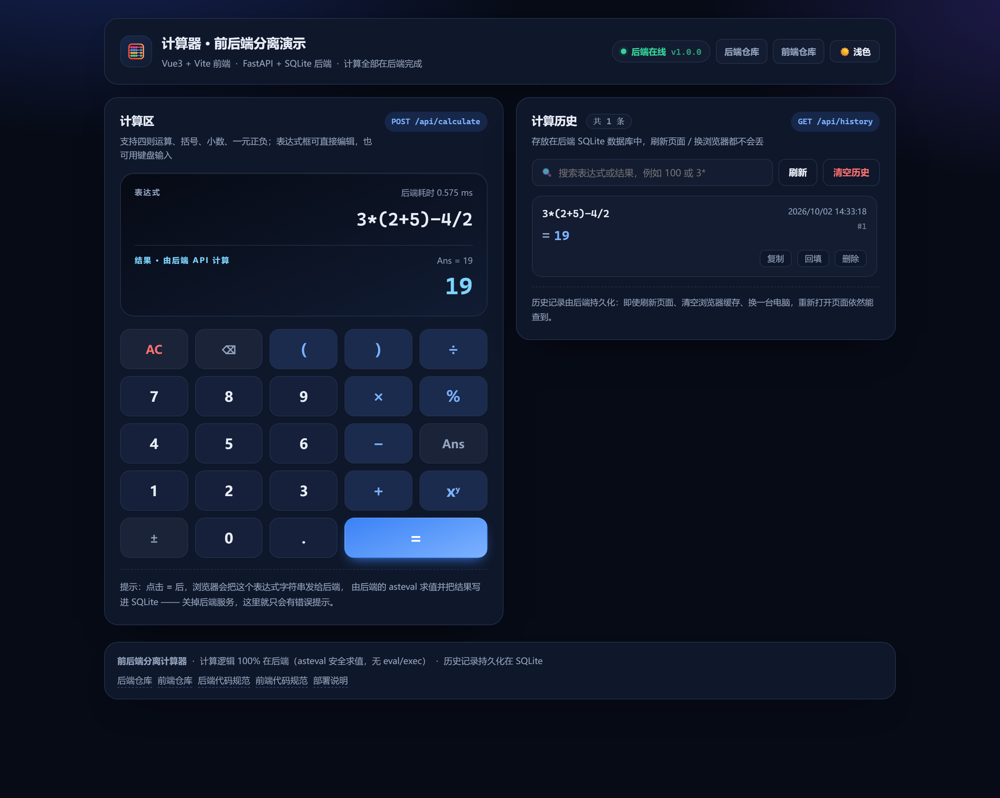

> 说明：用虚拟键盘依次点击 `3 × ( 2 + 5 ) − 4 ÷ 2`，再点 `=`。显示屏上半部分是**用户拼出来的表达式字符串**，下半部分是后端返回的结果 `19`，并标注"结果 · 由后端 API 计算"。右下角会弹出"后端计算完成"的提示。历史面板同时新增一条记录 —— 说明成功计算会立刻落库。

<a id="fig-3"></a>

**图 3-3　运算符优先级：`2+3×4−6÷3 = 12`**

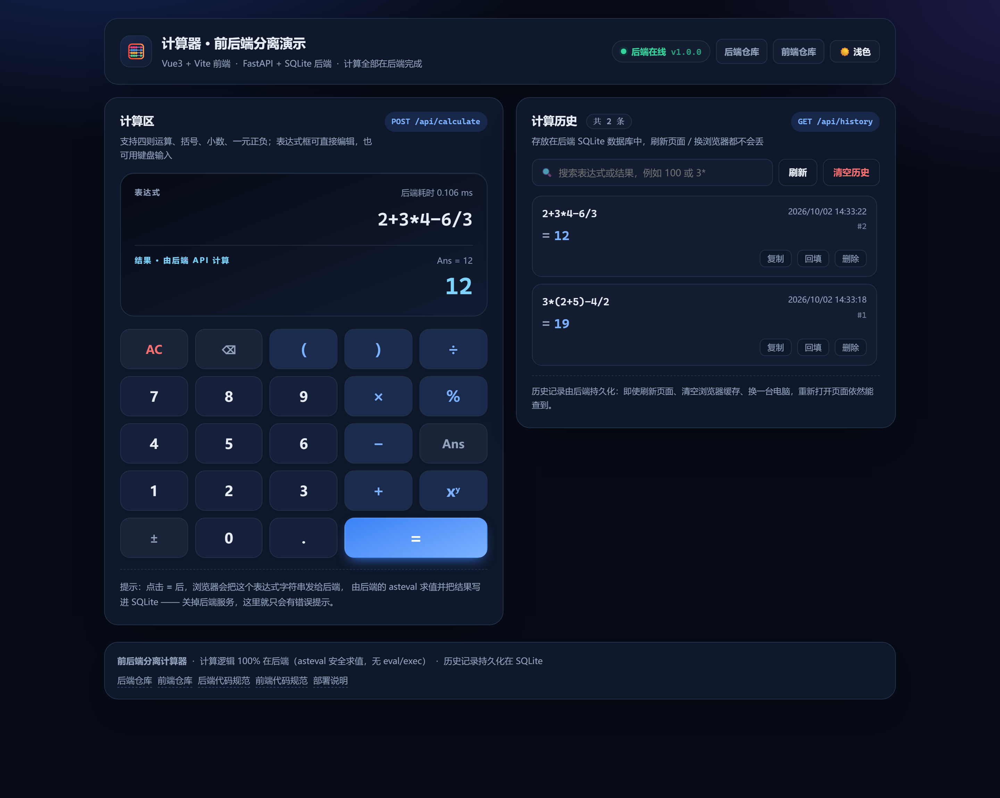

> 说明：如果按"从左到右"计算会得到 `18`，正确结果是 `12`，证明后端是按标准优先级求值的（`3×4=12`、`6÷3=2`，再 `2+12−2=12`）。

<a id="fig-4"></a>

**图 3-4　多级嵌套括号：`((2+3)×(4−1))÷5 = 3`**

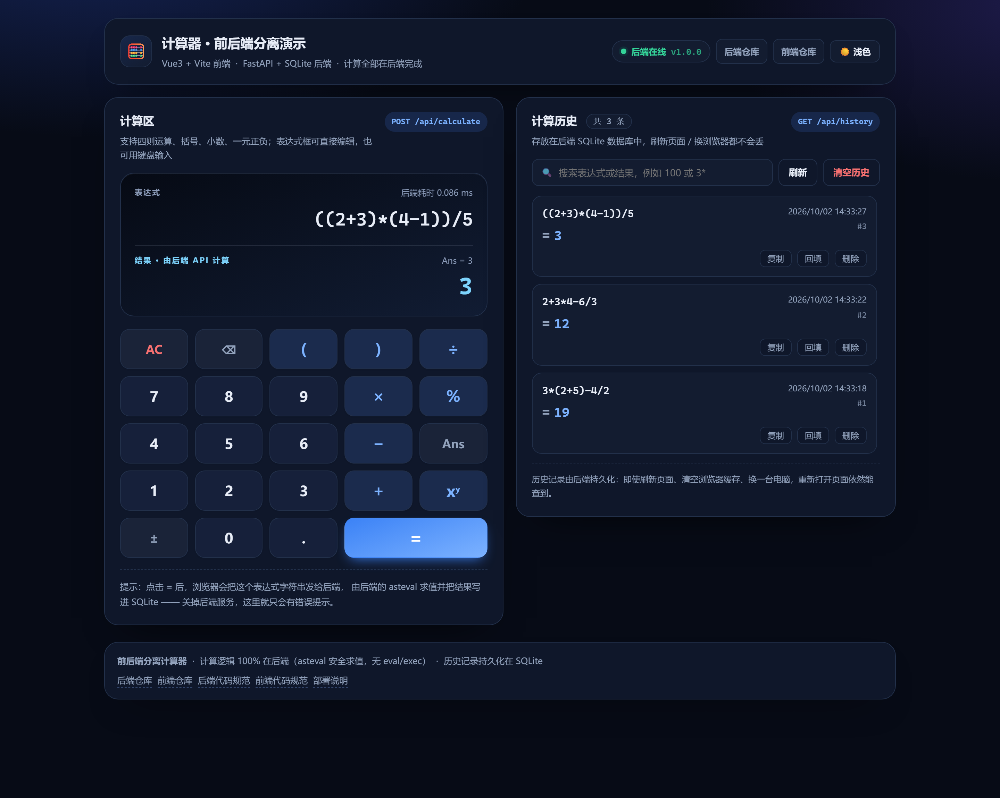

> 说明：两层括号嵌套仍然正确求值；括号不匹配时后端会明确报"括号不匹配"错误（见异常处理部分）。

<a id="fig-5"></a>

**图 3-5　小数与浮点误差：`0.1+0.2 = 0.3`**

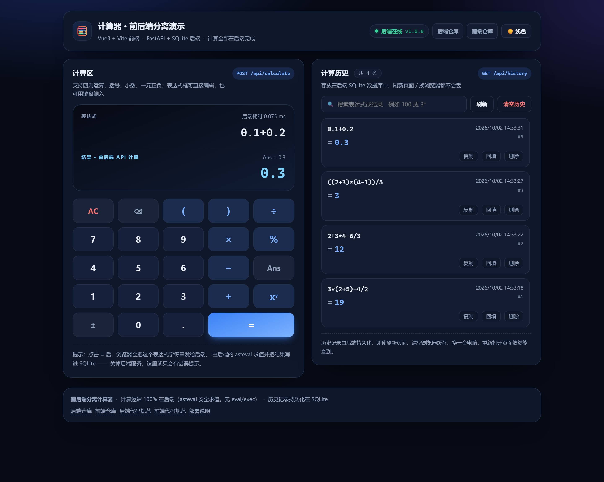

> 说明：JavaScript 与 Python 的浮点加法都会得到 `0.30000000000000004`。后端在格式化阶段用 12 位有效数字输出，界面上干净地显示 `0.3`；数据库里保存的也是这个最终展示值，避免"存的是 0.30000000000000004、显示的是 0.3"的不一致。

<a id="fig-6"></a>

**图 3-6　一元负号（键盘区）：`3×−2 = −6`**


> 说明：作业要求支持一元正负。这里直接点 `3 × − 2`，表达式就是 `3*-2`，后端正确解析为一元负号而不是"连续两个运算符"的语法错误；键盘区的 `±` 键还能把末尾数字包成 `(-数字)`。

<a id="fig-7"></a>

**图 3-7　一元正负（带空格写法）：`- 5 = -5`**


> 说明：作业原文的例子是 `- 5`（带空格）。表达式输入框可以直接编辑，因此可以键入 `- 5`。后端在归一化阶段压缩多余空格并交给解析器，结果 `-5` 正确。这条也说明**前端不拦表达式**，合法性完全由后端判定。

<a id="fig-8"></a>

**图 3-8　扩展运算符：`7%3 = 1` 与 `2^10 = 1024`**


> 说明：额外支持取模 `%` 与幂运算（`^` 或 `**`）。注意这里 `2^10 = 1024` 而不是 `8` —— Python 里 `^` 是按位异或，后端在归一化阶段把 `^` 统一替换成 `**`，避免"不报错但结果错"的隐蔽 bug。

### 3.2 历史记录：查看、搜索、删除

<a id="fig-9"></a>

**图 3-9　历史记录列表（共 8 条，最新在最上面）**


> 说明：每条记录包含表达式（如 `2 ^ 10`）、结果（`= 1024`）、创建时间、记录 id，以及"复制 / 回填 / 删除"三个操作。数据全部来自 `GET /api/history`，也就是后端 SQLite。

<a id="fig-10"></a>

**图 3-10　按关键字搜索历史**


> 说明：在搜索框输入 `2` 后，只显示表达式或结果里包含 `2` 的记录。搜索是**服务端过滤**（`GET /api/history?keyword=2`），前端只负责把关键字发出去 —— 这样前端依然不做任何数据处理。

<a id="fig-11"></a>

**图 3-11　删除单条历史：两步确认**


> 说明：点"删除"后按钮变成"确认删除 / 取消"，避免演示时误删。确认后前端调用 `DELETE /api/history/{id}`。

<a id="fig-12"></a>

**图 3-12　删除成功：提示与列表刷新**

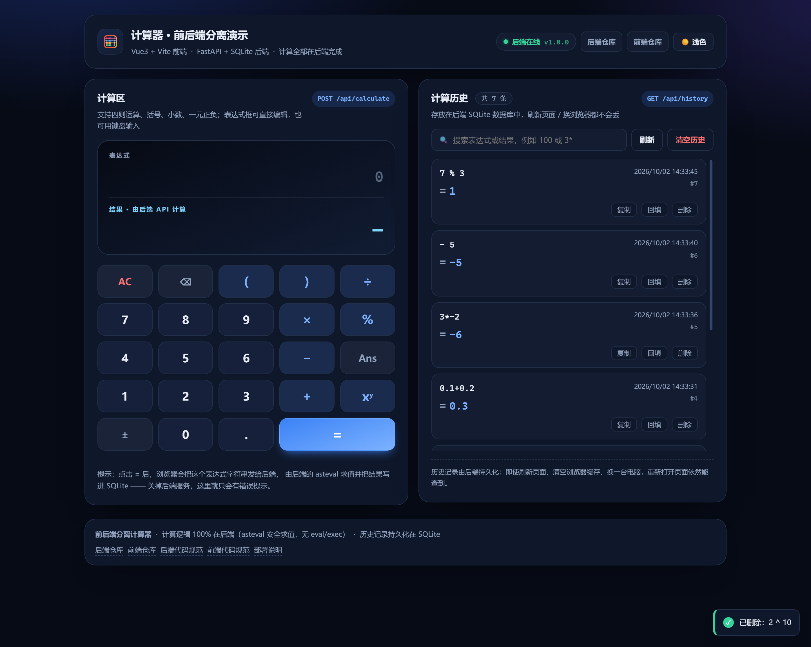

> 说明：右下角提示"已删除：2 ^ 10"，列表从 8 条变为 7 条。前端删除成功后**重新向后端拉一次列表**，而不是自己在前端减数字 —— 展示的数据永远以服务端返回为准。

<a id="fig-13"></a>

**图 3-13　主题切换（浅色主题）**

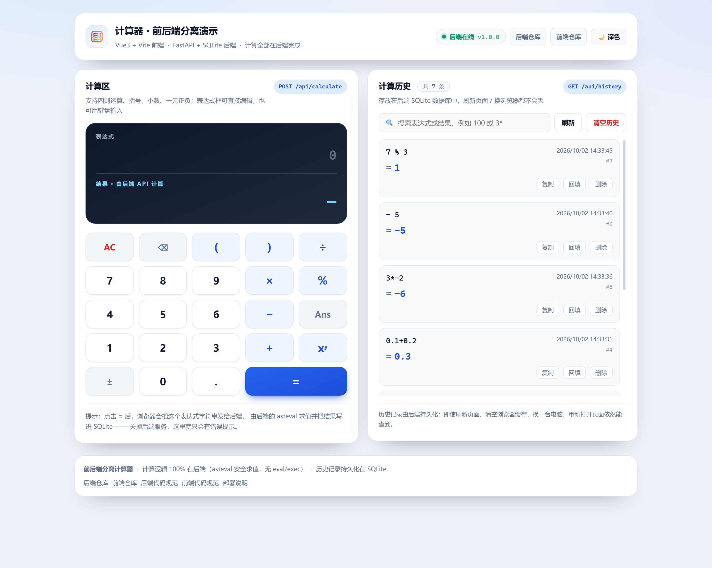

> 说明：默认跟随系统主题（本机是深色），点右上角按钮切换到浅色。主题只切换 CSS 变量，与计算逻辑无关（主题偏好存在 localStorage，**但计算历史绝不存前端**）。

### 3.3 异常处理

<a id="fig-14"></a>

**图 3-14　除零错误：`1÷0`**


> 说明：显示屏出现红色错误"除数不能为 0"，顶部表达式边框变红，结果区不显示错误的数字。**关键点：失败的计算不会写进历史**（右侧条数不变），这样历史里不会出现无用记录。

<a id="fig-15"></a>

**图 3-15　非法表达式：输入 `abc+1`**


> 说明：后端返回"表达式包含非法字符：'a' 'b' 'c'；仅支持数字、小数点、+ - * / ( ) % ^ 和空格"。字母在进入解析器之前就被字符白名单拦下，`__import__('os')` 这类注入同样在这一步被拒绝。

<a id="fig-16"></a>

**图 3-16　语法错误：输入 `3+`**


> 说明：运算符不完整会得到"表达式语法错误，请检查运算符是否连续、数字或括号是否完整"。前端只是把后端的 `message` 原样展示，错误文案统一由后端维护。

### 3.4 持久化与前后端分离的验证

<a id="fig-17"></a>

**图 3-17　刷新页面后历史仍在（数据在后端）**

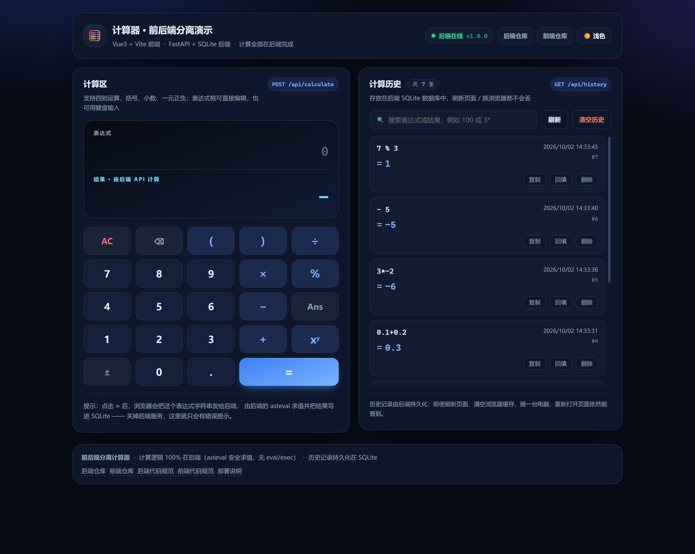

> 说明：连续刷新页面，历史记录依旧是 7 条 —— 因为它来自后端 SQLite，而不是前端的 localStorage。即使清空浏览器缓存、换一台电脑，历史也依然能查到。

<a id="fig-18"></a>

**图 3-18　响应式布局（430×932 移动端）**

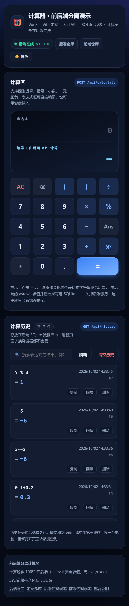

> 说明：窄屏下自动变成单栏布局，键盘与历史上下排列，按钮尺寸适合触屏。

<a id="fig-19"></a>

**图 3-19　★ 关闭后端服务后：前端算不出结果**


> 说明：这是对作业第 1 条硬性规则最直接的证明。把后端 `uvicorn` 进程杀掉后：
> ① 右上角状态灯变红显示 **后端离线**（`GET /api/health` 探测失败）；
> ② 点击 `=` 后显示屏报"无法连接后端服务：计算功能不可用"；
> ③ 历史记录也读不出来（显示 0 条）。
> **前端没有做任何降级计算**，因为它压根没有计算能力。

<a id="fig-20"></a>

**图 3-20　后端接口文档（`/docs`，Swagger UI 自动生成）**

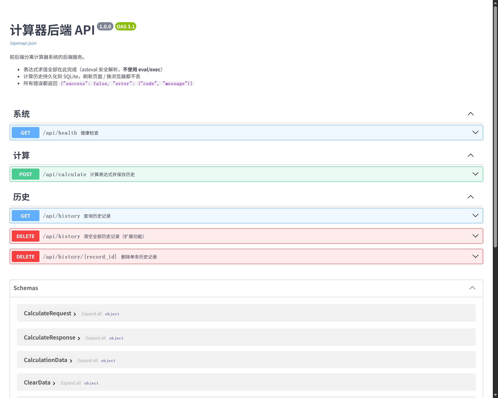

> 说明：后端基于 FastAPI 的 OpenAPI 自动生成交互式文档，助教可以直接在浏览器里点"Try it out"测试三个必需接口。截图里能看到 5 个接口按"系统 / 计算 / 历史"分组，以及 `CalculateRequest`、`CalculateResponse` 等数据模型。

---

<a id="sec-4"></a>

## 四、设计与实现过程

### 4.1 需求分析

#### 4.1.1 功能需求

| 编号 | 需求 | 验收标准 | 对应截图 |
| --- | --- | --- | --- |
| F1 | 基础四则运算 | `+ - × ÷` 均可正确计算 | [图 3-2](#fig-2) |
| F2 | 复合表达式与运算符优先级 | `2+3×4−6÷3 = 12`（而非 18） | [图 3-3](#fig-3) |
| F3 | 括号（含嵌套） | `((2+3)×(4−1))÷5 = 3`；括号不匹配要报错 | [图 3-4](#fig-4) |
| F4 | 小数运算 | `0.1+0.2` 显示 `0.3`，不出现浮点尾巴 | [图 3-5](#fig-5) |
| F5 | 一元正负 | `-5`、`- 5`、`3*-2` 均正确 | [图 3-6](#fig-6)、[图 3-7](#fig-7) |
| F6 | 异常处理 | 除零、非法表达式、语法错误都给出明确提示且不写库 | [图 3-14](#fig-14)~[图 3-16](#fig-16) |
| F7 | 保存与查看历史 | 计算成功立即落库；刷新页面历史不丢 | [图 3-9](#fig-9)、[图 3-17](#fig-17) |
| F8 | 删除单条历史 | 可删除指定 id 的记录，列表随之更新 | [图 3-11](#fig-11)、[图 3-12](#fig-12) |
| F9 | 三个必需 API | `POST /api/calculate`、`GET /api/history`、`DELETE /api/history/{id}` | [图 3-20](#fig-20) |

#### 4.1.2 非功能需求

| 编号 | 需求 | 落地方式 |
| --- | --- | --- |
| N1 | **安全**：绝不能执行用户输入 | 字符白名单 + 清空符号表的 asteval + 复杂度限制三层加固，另有一条"源码里不允许出现 `eval(`/`exec(`"的自检测试 |
| N2 | **可靠**：异常不能变成 500 堆栈 | 统一异常处理器把可预期错误翻译成 `4xx + 错误码`，兜底处理器保证任何异常都返回结构化信息 |
| N3 | **可测试**：核心逻辑要能被自动化验证 | 后端 68 条 pytest 用例（51 条求值引擎 + 17 条接口），每个用例独立数据库 |
| N4 | **易部署**：公网可访问 | 后端 `render.yaml` 一键蓝图 + `Dockerfile`；前端 `vercel.json` + 环境变量注入后端地址 |
| N5 | **可维护**：代码有规范 | 两个仓库各有 `README.md` + `codestyle.md`；后端用 ruff/black 规则集约束，前端用 Prettier/ESLint 约定约束 |

#### 4.1.3 硬性约束的拆解（作业规则 → 设计决策）

| 作业原文 | 设计决策 |
| --- | --- |
| 所有表达式计算逻辑必须放在后端 | 前端 `useCalculator` 只接受"往字符串末尾追加字符"这一种操作；**连"上次结果 Ans"也是把结果字符串当文本插入表达式**，不参与运算 |
| 关闭后端服务，前端无法算出新结果 | 前端**没有任何本地计算兜底**；`api/client.js` 把网络错误归一化成"无法连接后端服务"，直接展示错误（[图 3-19](#fig-19)） |
| 后端严禁使用 `eval`/`exec` | 采用 asteval 安全解析库；并用字符白名单把"名字/函数调用"这一类语法彻底挡在解析器之外 |
| 数据库持久化历史，至少含 id/expression/result/created_at | SQLite 表 `calculation_history` 四字段与要求一一对应，另加时间与表达式索引 |
| 3 个 API | 5 个接口：3 个必需 + 健康检查 + 清空历史（扩展） |

### 4.2 系统架构图

#### 4.2.1 总体架构（前后端分离，两个独立仓库）

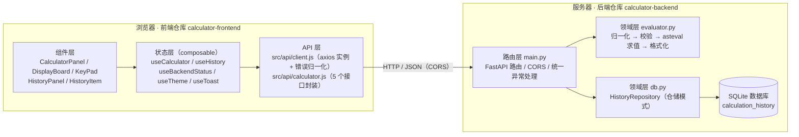

**架构说明**：前端三层（组件 → 状态 → API）单向依赖，组件不直接写 axios；后端路由层只做"参数校验 + 编排 + 响应组装"，具体求值与存储分别下沉到 `evaluator.py` 与 `db.py`。这样"计算能力"在物理上只存在于后端一个模块里，符合作业最核心的约束。

#### 4.2.2 一次计算的完整时序

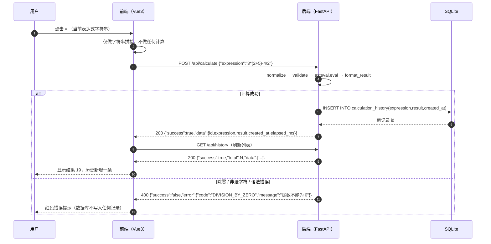

#### 4.2.3 模块依赖关系（后端）

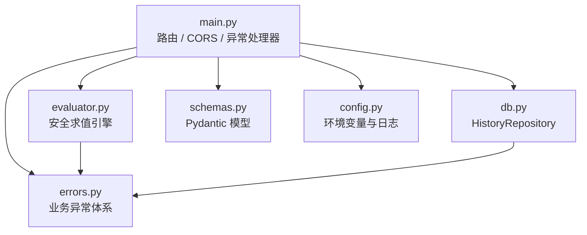

依赖方向是**单向**的：`errors.py` 谁都不依赖，`evaluator.py`/`db.py` 只依赖 `errors.py`，`main.py` 在顶层把它们组装起来。领域层不 import FastAPI，所以求值引擎和仓储都能被单元测试直接调用（不需要起 HTTP 服务）。

### 4.3 API 设计

#### 4.3.1 接口一览

| 方法 | 路径 | 说明 | 必需 |
| --- | --- | --- | --- |
| `POST` | `/api/calculate` | 计算表达式 → 成功后写入历史 → 返回结果 | ✅ 作业要求 |
| `GET` | `/api/history` | 查询历史（支持 `keyword` 搜索、`limit`/`offset` 分页） | ✅ 作业要求 |
| `DELETE` | `/api/history/{id}` | 删除指定 id 的单条历史 | ✅ 作业要求 |
| `DELETE` | `/api/history` | 清空全部历史（扩展） | ➕ 加分项 |
| `GET` | `/api/health` | 健康检查（前端状态灯、部署平台探活） | ➕ 加分项 |
| `GET` | `/docs` | Swagger UI 交互式文档 | 自动生成 |

#### 4.3.2 统一响应契约

```jsonc
// 成功：HTTP 200
{ "success": true, "total": 12, "data": { /* 业务数据 */ } }

// 失败：HTTP 400 / 404 / 422 / 500
{ "success": false, "error": { "code": "DIVISION_BY_ZERO", "message": "除数不能为 0" } }
```

之所以把 `code` 与 `message` 分开：`code` 是给程序用的稳定标识（前端可以据此做特殊处理，比如 404 时提示"记录已被删除"），`message` 是给用户看的中文文案。前端只需要处理一种错误结构，代码里没有到处 `if (error.response.data.detail)` 的判断。

#### 4.3.3 三个必需接口的详细定义

**① 计算表达式**

```http
POST /api/calculate
Content-Type: application/json

{ "expression": "3*(2+5)-4/2" }
```

| 状态码 | 响应体 | 说明 |
| --- | --- | --- |
| 200 | `{"success":true,"data":{"id":7,"expression":"3*(2+5)-4/2","result":"19","created_at":"2026-10-02T06:14:43+00:00","elapsed_ms":0.418}}` | 计算成功且已落库；`result` 是字符串，避免大整数与浮点精度在 JS 侧失真 |
| 400 | `{"success":false,"error":{"code":"DIVISION_BY_ZERO","message":"除数不能为 0"}}` | 除零 / 非法字符 / 语法错误 / 超长 / 过于复杂 |
| 422 | `{"success":false,"error":{"code":"VALIDATION_ERROR","message":"请求参数不合法：字段 expression …"}}` | 请求体字段类型不对（例如把 expression 传成数字） |
| 500 | `{"success":false,"error":{"code":"INTERNAL_ERROR","message":"服务器内部错误，请稍后重试"}}` | 未预期异常（不暴露堆栈） |

**② 查询历史**

```http
GET /api/history?keyword=2&limit=50&offset=0
```

```json
{
  "success": true,
  "total": 7,
  "data": [
    { "id": 7, "expression": "7 % 3", "result": "1", "created_at": "2026-10-02T06:33:45+00:00" },
    { "id": 6, "expression": "- 5",   "result": "-5", "created_at": "2026-10-02T06:33:40+00:00" }
  ]
}
```

**③ 删除单条历史**

```http
DELETE /api/history/7
```

| 状态码 | 响应体 |
| --- | --- |
| 200 | `{"success":true,"data":{"deleted_id":7,"deleted":true,"expression":"7 % 3","result":"1"}}` |
| 404 | `{"success":false,"error":{"code":"RECORD_NOT_FOUND","message":"历史记录 7 不存在或已被删除"}}` |

> 设计取舍：id 不存在时返回 **404 而不是静默 200**。前端据此可以给出准确提示（"这条记录已经被删掉了"），也便于自动化测试验证"删除真的生效了"。

#### 4.3.4 错误码总表

| HTTP | code | 触发场景 | 用户看到的文案 |
| --- | --- | --- | --- |
| 400 | `EMPTY_EXPRESSION` | 表达式为空或全是空格 | 表达式不能为空 |
| 400 | `EXPRESSION_TOO_LONG` | 超过 200 字符 | 表达式过长，请缩短后再试 |
| 400 | `ILLEGAL_CHARACTER` | 含字母、引号、下划线等 | 表达式包含非法字符：'a' 'b' 'c'；仅支持数字、小数点、+ - * / ( ) % ^ 和空格 |
| 400 | `UNBALANCED_PARENTHESES` | 左右括号数量不等 | 括号不匹配：左括号 1 个，右括号 0 个 |
| 400 | `SYNTAX_ERROR` | `3+`、`1+*2`、`*5`、`3..5` | 表达式语法错误，请检查运算符是否连续、数字或括号是否完整 |
| 400 | `DIVISION_BY_ZERO` | `1/0`、`5%0` | 除数不能为 0 |
| 400 | `EXPRESSION_TOO_COMPLEX` | `9**9**9`、`2**100000` | 为保证服务稳定，一个表达式最多支持一次幂运算（** 或 ^） |
| 400 | `RESULT_OVERFLOW` | 结果超出可表示范围 | 计算结果超出可表示范围 |
| 400 | `UNSUPPORTED_OPERATION` | 结果是复数 / 元组等非实数 | 暂不支持复数运算 |
| 404 | `RECORD_NOT_FOUND` | 删除不存在的 id | 历史记录 N 不存在或已被删除 |
| 422 | `VALIDATION_ERROR` | 请求体字段类型错误 | 请求参数不合法：字段 expression … |
| 500 | `DATABASE_ERROR` / `INTERNAL_ERROR` | 数据库或服务端异常 | 服务器内部错误，请稍后重试 |

### 4.4 数据库设计

#### 4.4.1 表结构

```sql
CREATE TABLE IF NOT EXISTS calculation_history (
    id         INTEGER PRIMARY KEY AUTOINCREMENT,  -- 主键，自增
    expression TEXT    NOT NULL,                   -- 用户输入的原始表达式（含 × ÷ 等符号）
    result     TEXT    NOT NULL,                   -- 后端计算出的结果（字符串保存）
    created_at TEXT    NOT NULL                    -- 创建时间，ISO 8601（UTC）
);

CREATE INDEX IF NOT EXISTS idx_history_created_at ON calculation_history (created_at DESC);
CREATE INDEX IF NOT EXISTS idx_history_expression  ON calculation_history (expression);
```

| 字段 | 类型 | 约束 | 说明 |
| --- | --- | --- | --- |
| `id` | INTEGER | 主键、自增 | 对应 API 里的记录 id，也是删除接口的入参 |
| `expression` | TEXT | NOT NULL | 存**用户原文**（例如 `3 × 4`、`- 5`），不是归一化之后的字符串，用户回看时更亲切 |
| `result` | TEXT | NOT NULL | 存最终展示值（字符串） |
| `created_at` | TEXT | NOT NULL | ISO 8601 带时区（`2026-10-02T06:14:43+00:00`） |

#### 4.4.2 三个关键设计决策

1. **`result` 用 `TEXT` 而不是 `REAL`**：`10/3` 用浮点存会再次引入精度问题；`2**100` 这样的整数超出 JavaScript 的 `Number.MAX_SAFE_INTEGER`，JSON 传输到前端会失真。字符串是"最终展示值"，原样存原样传最稳。
2. **`created_at` 带时区偏移**：前端 `new Date(created_at)` 一句就能解析成本地时间，**前端不需要做任何时区换算或时间加减**（这也是"前端不做计算"的一部分，见 [5.6](#sec-5)）。
3. **连接管理采用"每次操作新建、用完即关"**：FastAPI 的同步路由跑在线程池里，`sqlite3` 连接不能跨线程复用；SQLite 建连接的开销极小，配 `PRAGMA journal_mode=WAL` 后足以支撑课程演示量级。所有 SQL 都是**参数化查询**（`?` 占位），不存在字符串拼接 SQL 的注入风险。

#### 4.4.3 为什么坚持后端持久化

| 方案 | 刷新页面 | 换浏览器 / 换设备 | 清缓存 | 是否符合作业 |
| --- | --- | --- | --- | --- |
| 前端 `localStorage` | 保留 | **丢失** | **丢失** | ❌ 作业明确禁止"只用前端 localStorage" |
| 后端 SQLite（本项目） | 保留 | 保留 | 保留 | ✅ |

[图 3-17](#fig-17) 就是对这一点的现场验证。

### 4.5 模块设计

#### 4.5.1 后端模块

| 文件 | 层次 | 职责 | 关键点 |
| --- | --- | --- | --- |
| `main.py` | 路由层 | 5 个接口、CORS、统一异常处理器、生命周期建表 | 同步路由跑在线程池，避免阻塞事件循环 |
| `evaluator.py` | 领域层 | **唯一**的表达式求值入口 | 归一化 → 校验 → asteval 求值 → 结果格式化；四层安全加固 |
| `db.py` | 领域层 | `HistoryRepository`（仓储模式）封装建表与增删查 | 参数化 SQL、WAL、连接即用即关 |
| `schemas.py` | 契约层 | 请求/响应 Pydantic 模型 | 模型即接口文档；`result` 定义为 `str` |
| `errors.py` | 基础层 | 业务异常体系（`code` + `status_code` + 中文 `message`） | 可预期错误全部继承 `CalculatorError` |
| `config.py` | 基础层 | 环境变量与日志配置 | 部署时无需改代码，只改环境变量 |

#### 4.5.2 前端模块

| 文件 | 职责 | 关键点 |
| --- | --- | --- |
| `src/App.vue` | 根组件：布局 + 事件串联 | 只搬运字符串与事件，不计算 |
| `src/components/CalculatorPanel.vue` | 计算区：显示屏 + 键盘 + 物理键盘监听 | 计算成功向上抛 `calculated`，由历史面板重新拉取 |
| `src/components/DisplayBoard.vue` | 显示屏：表达式输入框 + 结果 + 错误 | 表达式区可直接编辑，仍只是字符串 |
| `src/components/KeyPad.vue` / `KeyButton.vue` | 25 键虚拟键盘 | 按键只描述"追加什么字符"或"触发哪个动作" |
| `src/components/HistoryPanel.vue` / `HistoryItem.vue` | 历史列表、搜索、两步删除 | 数据全部来自 `GET /api/history` |
| `src/components/AppHeader.vue` | 顶栏：后端状态灯、主题切换、仓库链接 | 状态灯由 `/api/health` 驱动 |
| `src/components/AppToast.vue` | 消息提示 | 成功/失败反馈 |
| `src/composables/useCalculator.js` | 表达式字符串与提交流程 | **零计算**：只有字符串拼接、截取与 API 调用 |
| `src/composables/useHistory.js` | 历史列表状态 | 删除后重新拉取列表，不在前端自行增减计数 |
| `src/composables/useBackendStatus.js` | 周期性健康检查 | 30 秒探活，界面显示在线/离线 |
| `src/composables/useTheme.js` / `useToast.js` | 主题与提示 | 主题存 localStorage，历史**不存** |
| `src/api/client.js` / `calculator.js` | axios 实例与 5 个接口封装 | 响应拦截器统一把错误归一化成 `{code,message,status}` |
| `src/constants/keypad.js` / `links.js`、`src/utils/format.js` | 键盘布局、外链、时间格式化 | 时间只做本地化展示，不做相对时间 |

#### 4.5.3 组件通信方式

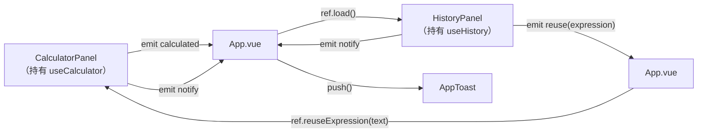

整体是**单向数据流**：子组件通过事件向上报告"发生了什么事"，父组件通过 `ref` 调用子组件暴露的方法触发动作；没有任何跨组件的双向绑定或全局状态库，符合课程项目"够用即可"的复杂度控制。

### 4.6 异常处理设计

#### 4.6.1 设计原则

1. **可预期错误用异常对象表达，不用返回值表达**：`evaluator.evaluate()` 成功返回字符串，失败抛 `CalculatorError` 子类。路由里因此只有"顺利路径"，不必层层判断 `if result is None`。
2. **后端负责文案，前端只负责展示**：错误提示统一由后端 `message` 给出，前端不做文案拼装，将来做多语言也只需要改后端。
3. **失败绝不写库**：只有 `evaluate()` 成功返回后才会调用 `repo.create()`，所以历史里不会出现"出错的表达式"（[图 3-14](#fig-14) 右侧条数不变）。
4. **兜底不让堆栈外泄**：注册了 `Exception` 级别的处理器，任何未预料异常都返回 `{"code":"INTERNAL_ERROR"}` 并记录到服务端日志。

#### 4.6.2 异常处理链路

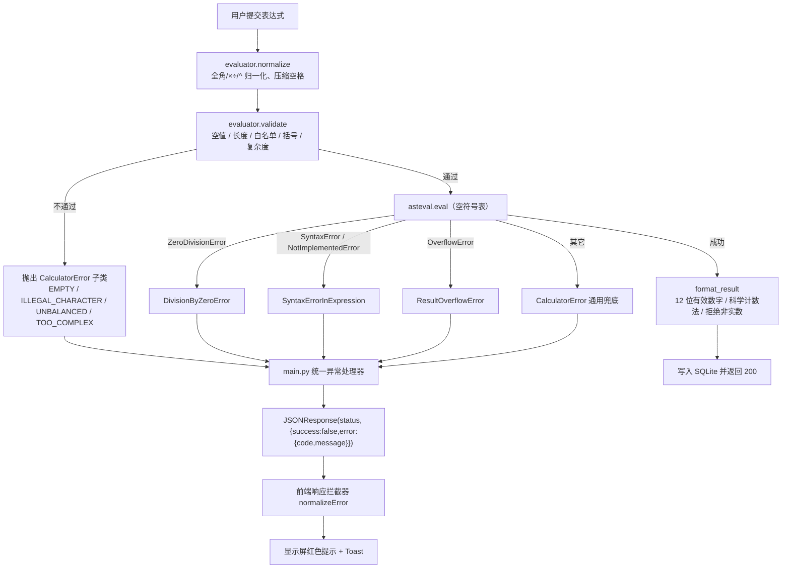

#### 4.6.3 前端侧的错误处理

前端只有一处错误处理入口 —— `src/api/client.js` 的响应拦截器：

```js
// http.interceptors.response.use(成功直通, 失败统一归一化)
if (error?.response) {
  const { status, data } = error.response
  const detail = data?.error || {}
  return { code: detail.code || `HTTP_${status}`, message: detail.message || `请求失败（HTTP ${status}）`, status }
}
if (error?.code === 'ECONNABORTED') return { code: 'TIMEOUT', message: '请求超时：后端服务响应过慢，请稍后重试', status: 0 }
return { code: 'NETWORK_ERROR', message: '无法连接后端服务：计算功能不可用（历史记录仍可查看）', status: 0 }
```

这样组件层拿到的永远是 `{code, message}`，不需要知道 axios 的错误结构；"后端离线的兜底文案"也集中在这一处（[图 3-19](#fig-19) 显示的就是它）。

#### 4.6.4 测试覆盖

| 测试文件 | 用例数 | 覆盖内容 |
| --- | ---: | --- |
| `tests/test_evaluator.py` | 51 | 正常运算 27 条参数化用例 + 除零 / 取模除零 / 语法错误 / 括号不匹配 / 空表达式 / 非法字符 / 超长 / 过于复杂 / 归一化 / 可复用性 / **源码不得出现 eval 的自检** |
| `tests/test_api.py` | 17 | 计算成功落库、中文符号、除零不写库、非法字符、空表达式、语法错误、参数校验、排序、搜索、分页、空库、删除成功、删除 404、清空、健康检查、未知路由、**仓储重启后数据仍在** |
| 合计 | **68** | `pytest` 全绿，耗时约 1.5 秒 |

### 4.7 部署流程

#### 4.7.1 部署拓扑

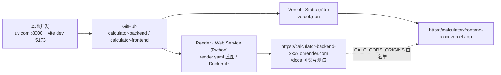

#### 4.7.2 后端部署到 Render（推荐，本项目采用）

1. 把后端仓库推到 GitHub（`main` 分支）。
2. 登录 [Render](https://render.com) → **New → Blueprint** → 选择 `calculator-backend` 仓库 → **Apply**。
   仓库内的 `render.yaml` 已经声明好：运行时 Python、构建命令 `pip install -r requirements.txt`、启动命令 `uvicorn main:app --host 0.0.0.0 --port $PORT`、健康检查路径 `/api/health`、Python 版本 3.12.5。
3. 等待构建完成，得到形如 `https://calculator-backend-xxxx.onrender.com` 的地址。
4. **验证**：浏览器打开 `https://<后端域名>/docs`，能看到 [图 3-20](#fig-20) 的 Swagger 页面即部署成功；再访问 `/api/health` 应返回 `record_count` 等运行信息。
5. 把前端域名写进 CORS 白名单（安全加固）：
   环境变量 `CALC_CORS_ORIGINS = https://calculator-frontend-xxxx.vercel.app`（多个域名用英文逗号分隔）。

#### 4.7.3 前端部署到 Vercel

1. 把前端仓库推到 GitHub。
2. 登录 [Vercel](https://vercel.com) → **Add New → Project** → 导入 `calculator-frontend`；框架会被识别为 Vite，构建命令 `npm run build`、输出目录 `dist`（`vercel.json` 里也显式声明了）。
3. **配置环境变量**（关键一步）：`VITE_API_BASE_URL = https://calculator-backend-xxxx.onrender.com`。
   Vite 的环境变量在**构建期**注入，所以修改变量后必须重新部署一次。
4. 部署完成后打开前端站点，右上角状态灯应显示"后端在线"。

#### 4.7.4 部署验证清单

| 检查项 | 期望结果 |
| --- | --- |
| 打开后端 `/docs` | Swagger 页面正常，5 个接口分组显示 |
| 打开后端 `/api/health` | `{"success":true,"data":{"status":"ok",...}}` |
| 打开前端首页 | 状态灯"后端在线"，历史面板加载出数据 |
| 前端算 `3*(2+5)-4/2` | 显示 `19`，历史新增一条 |
| 刷新前端页面 | 历史仍在（来自后端数据库） |
| 前端删除一条历史 | 提示"已删除"，列表少一条；再刷新仍然少一条 |
| 浏览器控制台 | 无 CORS 报错 |

#### 4.7.5 部署踩坑提示（写给自己也写给助教）

* **Render 免费实例会休眠**：15 分钟无请求后实例休眠，下一次访问需要约 30–60 秒冷启动。助教测试时如果第一次打开很慢，请稍等或先访问一次 `/api/health` 唤醒。
* **Render 免费实例没有持久磁盘**：**重新部署**会重置容器文件系统，SQLite 文件随之清空。作业验收期间不要重新部署即可；若要长期保留历史，需升级付费实例并挂载磁盘（`render.yaml` 里已注释好对应配置，把 `CALC_DB_PATH` 指向挂载目录即可）。
* **前端环境变量是构建期注入**：Vercel 上改了 `VITE_API_BASE_URL` 一定要重新 Deploy，否则打包产物里还是旧地址。
* **CORS 与缓存**：如果改了后端 CORS 配置后前端仍报跨域，先确认 Render 是否已重新部署、浏览器是否命中了旧的预检缓存。

---

<a id="sec-5"></a>

## 五、核心代码说明

本节只挑**最关键的 6 段代码**讲解设计意图与边界，不贴全量源码（完整代码见两个仓库）。所有片段都可以在仓库里按文件名搜到。

### 5.1 安全求值引擎：四层加固（`backend/evaluator.py`）

作业明令禁止 `eval`/`exec`。本项目用 `asteval` 做实际求值，并在它外面套了四层防护，形成"纵深防御"：

```python
def evaluate(self, raw_expression: str) -> str:
    expression = self.normalize(raw_expression)   # ① 归一化：全角/×÷/^ → Python 运算符
    self.validate(expression)                     # ② 白名单 + 长度 + 括号 + 复杂度
    value = self._run(expression)                 # ③ asteval 在**空符号表**上求值
    return self.format_result(value, expression)  # ④ 结果格式化并拒绝非实数
```

```python
def _harden_symbol_table(self) -> None:
    """清空 asteval 符号表：表达式里不允许出现任何函数名 / 变量名。"""
    try:
        self._interpreter.symtable.clear()
    except Exception:  # pragma: no cover - 不同 asteval 版本兼容
        logger.warning("无法清空 asteval 符号表，已退化为仅依赖字符白名单")

def validate(self, expression: str) -> None:
    if not expression:
        raise EmptyExpressionError()
    if len(expression) > MAX_EXPRESSION_LENGTH:            # 200 字符
        raise ExpressionTooLongError(...)
    if _ALLOWED_PATTERN.fullmatch(expression) is None:      # 白名单：0-9 + - * / ( ) . % ^ 空格
        illegal = sorted(set(_ILLEGAL_CHARACTER_PATTERN.findall(expression)))
        raise IllegalCharacterError(f"表达式包含非法字符：{' '.join(...)}", expression=expression)
    if expression.count("(") != expression.count(")"):
        raise UnbalancedParenthesesError(...)
```

**讲解**：
* 第 ① 层把用户输入的 `× ÷ −` 和全角符号翻译成 Python 运算符，所以前端可以放心用漂亮的数学符号，后端负责"翻译"；
* 第 ② 层是**最重要的一层**：字母、引号、下划线、方括号、分号全被拒绝，`__import__('os')`、`1+2; rm -rf /` 在进入解析器之前就死了。因为没有"名字"能出现，asteval 的符号表被清空后（`len(symtable) == 0`）即使白名单被绕过也没有任何可调用的对象；
* 校验与求值分离，好处是**校验逻辑可以单独测试**，51 条单元测试里有一大半在打这一层；
* `_evaluator_pool` 按线程保存独立的 `SafeEvaluator`（asteval 实例内部有可变错误栈，不是线程安全的），配合 FastAPI 线程池是安全的。

### 5.2 两个"看起来能跑但结果不对"的坑：`^` 与 `9**9**9`（`backend/evaluator.py`）

```python
@staticmethod
def normalize(raw_expression: str) -> str:
    """去掉首尾空白、翻译全角符号、把 ^ 统一成 Python 的幂运算 **。

    为什么要替换 `^`：Python 里 `^` 是**按位异或**，`2^10` 会得到 8 而不是 1024。
    """
    if raw_expression is None:
        return ""
    text = str(raw_expression).translate(_TRANSLATION_TABLE).strip()
    text = text.replace("^", "**")
    text = re.sub(r"\s+", " ", text)
    return text
```

```python
power_operators = _POWER_OPERATOR_PATTERN.findall(expression)
if len(power_operators) > MAX_POWER_OPERATORS:          # 最多一次幂运算
    raise ExpressionTooComplexError("为保证服务稳定，一个表达式最多支持一次幂运算（** 或 ^）")
for match in _POWER_EXPONENT_PATTERN.finditer(expression):
    if int(match.group(1)) > MAX_POWER_EXPONENT:        # 指数 ≤ 1000
        raise ExpressionTooComplexError(f"幂运算的指数不能超过 {MAX_POWER_EXPONENT}")
```

**讲解**：
* 第一个坑是**语义坑**：Python 的 `^` 是按位异或，`2^10 = 8`。如果不做归一化，用户输入的 `2^10` 会"计算成功但结果完全不对"，这种 bug 比报错更可怕。统一替换成 `**` 之后，`2^10` 得到 `1024`，而且复杂度检查只需处理一种形式。
* 第二个坑是**安全坑**：`9**9**9` 只有 6 个字符，却会让解释器算到天荒地老（`9**387420489`）。因为幂运算不是作业要求的能力，我选择用"最多一次幂运算 + 指数上限 1000"这种**保守但可解释**的限制，宁可拒绝也不让服务被一个表达式打满 CPU。取舍写在 README 和 [6.1](#sec-6) 的踩坑表里。
* 这条规则也顺带证明了"限制要写在文档里"：作业验收时如果有人问"为什么 `2**3**2` 被拒绝"，README 第四节有明确答案。

### 5.3 统一异常体系：让"错误"也成为一种设计（`backend/errors.py` + `main.py`）

```python
class CalculatorError(Exception):
    """所有业务异常的基类。"""
    code: str = "CALCULATOR_ERROR"
    status_code: int = HTTPStatus.BAD_REQUEST
    default_message: str = "计算失败，请检查表达式"

    def __init__(self, message: str | None = None, *, expression: str | None = None) -> None:
        self.message = message or self.default_message
        self.expression = expression
        super().__init__(self.message)

    def to_payload(self) -> dict:
        error: dict[str, object] = {"code": self.code, "message": self.message}
        if self.expression is not None:
            error["expression"] = self.expression
        return {"success": False, "error": error}
```

```python
@app.exception_handler(CalculatorError)
async def handle_calculator_error(request: Request, exc: CalculatorError) -> JSONResponse:
    if exc.status_code >= 500:
        logger.exception("服务端异常：%s", exc.message)
    else:
        logger.warning("业务异常 [%s] %s | 表达式：%s", exc.code, exc.message, exc.expression)
    return JSONResponse(status_code=exc.status_code, content=exc.to_payload())
```

**讲解**：
* **错误码、HTTP 状态码、用户文案三件套绑在异常类上**，抛异常的地方只需要 `raise DivisionByZeroError(...)`，不用在每个路由里重复组织响应结构；
* 求值层抛出的 `ZeroDivisionError / SyntaxError / NotImplementedError / OverflowError` 会被 `_translate_error()` 翻译成上面这套异常（见 [5.2](#sec-5) 与 [6.1](#sec-6) 里 `*5` 的例子），所以**路由层永远不会看到底层库的异常类型**；
* 日志分级很实用：业务错误（用户输错表达式）打 `warning` 且带表达式原文；服务端异常打 `exception` 带堆栈。部署到 Render 后排查问题直接看日志面板就能定位；
* 另外还注册了 `RequestValidationError`（Pydantic 校验失败）和 `Exception` 两个处理器，保证**任何**情况下前端拿到的都是 `{success:false,error:{code,message}}`，不会出现"有时是 `detail`、有时是 `error`"的混乱。

### 5.4 历史持久化：仓储模式 + 即用即关的连接（`backend/db.py`）

```python
@contextmanager
def _connection(self) -> Iterator[sqlite3.Connection]:
    connection = self._connect()
    try:
        yield connection
        connection.commit()
    except sqlite3.Error as exc:
        connection.rollback()
        raise DatabaseError(f"数据库操作失败：{exc}") from exc
    finally:
        connection.close()

def create(self, expression: str, result: str) -> dict[str, Any]:
    created_at = _now_iso()          # ISO 8601（UTC，带时区偏移）
    with self._connection() as connection:
        cursor = connection.execute(
            "INSERT INTO calculation_history (expression, result, created_at) VALUES (?, ?, ?)",
            (expression, result, created_at),      # 参数化查询，杜绝 SQL 注入
        )
        new_id = int(cursor.lastrowid)
    return {"id": new_id, "expression": expression, "result": result, "created_at": created_at}
```

**讲解**：
* 用 `contextmanager` 把「提交 / 回滚 / 一定关闭」收敛到一处，业务方法里只写 SQL，不必每个方法都写 `try/finally`；
* `sqlite3.Error` 被翻译成 `DatabaseError`（对应 HTTP 500 + `DATABASE_ERROR`），**数据库故障不会伪装成"表达式错误"**；
* 连接**即用即关**：FastAPI 的同步路由跑在线程池里，连接不能跨线程共享；SQLite 建连接开销很小，配合 `WAL` + `synchronous=NORMAL` 足够课程场景使用。这是一个"用简单换正确"的取舍；
* 返回的字典直接就是 API 响应的 `data`（含数据库生成的 `id` 和时间），路由层不需要再做二次拼装；
* 测试里有一条 `test_history_survives_repository_restart`：**新建一个仓储对象读同一个文件**，证明数据真的落盘了，而不是活在内存里。

### 5.5 前端零计算：所有操作都是"改字符串"（`frontend/src/composables/useCalculator.js`）

```js
/** 追加一个字符（纯字符串拼接） */
function appendToken(token) {
  if (typeof token !== 'string' || token === '') return

  // 计算器习惯：当前面是 ")"（± 或括号产生）时，继续点数字要插到括号里面
  if (APPEND_BEFORE_TRAILING_PAREN.test(token) && expression.value.endsWith(')')) {
    const closeIndex = expression.value.length - 1
    expression.value =
      expression.value.slice(0, closeIndex) + token + expression.value.slice(closeIndex)
    return
  }

  expression.value += token
}

/** ±：把末尾数字包成 (-数字)，再按一次还原（纯字符串替换，不做取负运算） */
function toggleSign() {
  const current = expression.value
  if (!current) return
  const wrapped = current.match(WRAPPED_NEGATIVE)        // /\(-(\d+\.?\d*)\)$/
  if (wrapped) {
    expression.value = current.slice(0, current.length - wrapped[0].length) + wrapped[1]
    return
  }
  const trailing = current.match(TRAILING_NUMBER)        // /(\d+\.?\d*)$/
  if (!trailing) return
  const numberStart = current.length - trailing[0].length
  expression.value = `${current.slice(0, numberStart)}(-${trailing[0]})`
}
```

```js
/** 把表达式提交给后端计算，结果显示到界面 */
async function evaluate() {
  const submitted = expression.value.trim()
  if (!submitted) {
    errorMessage.value = '请先输入表达式，例如 3*(2+5)-4/2'
    return
  }
  isCalculating.value = true
  errorMessage.value = ''
  try {
    const payload = await calculateApi(submitted)     // POST /api/calculate
    result.value = payload.data.result
    lastAnswer.value = payload.data.result            // 供 Ans 使用：只是把结果当文本
    elapsedMs.value = payload.data.elapsed_ms ?? null
    onSuccess?.(data)
  } catch (error) {
    result.value = ''
    errorMessage.value = error.message                // 文案来自后端
    onError?.(error)
  } finally {
    isCalculating.value = false
  }
}
```

**讲解**：
* 整个文件里**找不到一次算术运算**：没有 `+ - * /` 作用于数值，没有 `Math.*`，没有 `Number()/parseFloat()`。`±` 键看起来像"取负"，实现上只是把末尾数字替换成 `(-数字)` 文本；`Ans` 键只是把上一次的结果**字符串**插回表达式。这两个功能最容易被写成"前端自己算一下"，但一旦这么做就违反了作业规则；
* `evaluate()` 只做三件事：把字符串交给后端、把返回的结果放到界面、把错误信息放到界面；
* 失败时清空 `result`，避免"上一次的 19 还挂在屏幕上，用户以为 `1/0=19`"这种误解；
* 因为前端不理解表达式，所以**表达式合法性的唯一裁判是后端**（[图 3-15](#fig-15) 的 `abc+1` 就是前端原样发出去、后端判定为非法的）。

### 5.6 前端错误归一化与后端状态探活（`frontend/src/api/client.js` + `useBackendStatus.js`）

```js
export function normalizeError(error) {
  if (error?.response) {                        // 后端返回了结构化错误
    const { status, data } = error.response
    const detail = data?.error || {}
    return {
      code: detail.code || `HTTP_${status}`,
      message: detail.message || `请求失败（HTTP ${status}）`,
      status,
    }
  }
  if (error?.code === 'ECONNABORTED') {
    return { code: 'TIMEOUT', message: '请求超时：后端服务响应过慢，请稍后重试', status: 0 }
  }
  return { code: 'NETWORK_ERROR', message: '无法连接后端服务：计算功能不可用（历史记录仍可查看）', status: 0 }
}
```

```js
async function check() {
  try {
    const payload = await fetchHealth()     // GET /api/health
    info.value = payload.data
    status.value = 'online'
  } catch {
    info.value = null
    status.value = 'offline'               // 界面状态灯变红
  }
}
onMounted(() => { check(); heartbeat = setInterval(check, HEARTBEAT_INTERVAL_MS) })
```

**讲解**：
* 所有 axios 错误在**拦截器里一次归一化**，组件层只处理 `{code, message}`。这样后端新增错误码时，前端不需要改代码就能显示新文案；
* `NETWORK_ERROR` 这条兜底文案正是[图 3-19](#fig-19) 里显示的那句 —— "后端挂了" 在前端是一个**明确的、可展示的状态**，而不是一个未捕获的异常或空白页面；
* 30 秒一次的健康探活让"前后端分离"这件事**可视化**了：状态灯就是后端存活状态的真实反映，也是演示时的第一个检查点。

---

<a id="sec-6"></a>

## 六、个人收获与踩坑总结

### 6.1 踩坑记录（现象 → 原因 → 解决）

| # | 现象 | 原因 | 解决方式 |
| --- | --- | --- | --- |
| 1 | `2^10` "计算成功"但得到 `8` | Python 的 `^` 是**按位异或**，不是幂运算 | 在归一化阶段把 `^` 统一替换为 `**`；这类"不报错但结果错"的问题最危险，必须靠测试用例锁住 |
| 2 | 输入 `*5` 得到"表达式运算量过大"这种错误提示 | asteval 对残缺表达式抛的是 `NotImplementedError('starred')`，不是 `SyntaxError`，我最初的异常映射把它归到了"过于复杂" | 把 `NotImplementedError` 一并映射为 `SYNTAX_ERROR`，并补上单元测试（`test_syntax_errors` 参数化覆盖 `*5`） |
| 3 | 后端 `pip install -r requirements.txt` 报 `UnicodeDecodeError: 'gbk' codec can't decode byte 0x80` | 需求文件里写了中文注释，而中文 Windows 下 pip 以 GBK 解码该文件 | `requirements.txt` / `requirements-dev.txt` **保持纯 ASCII**，把说明写进 README。这个坑在部署到 Linux 前完全看不出来 |
| 4 | `pytest` 全部夹具报错 `PermissionError: [WinError 5]` | pytest 的 `tmp_path` 用 `mode=0o700` 创建临时目录，在本机受限安全环境下**连创建者自己都无法枚举**该目录（PowerShell 建的目录却正常） | 夹具改为在 `tests/` 下用 uuid 命名临时数据库文件（跑完删除 `-wal/-shm`），隔离性不变且更健壮；原因写在 `conftest.py` 注释里 |
| 5 | 删除历史后，列表上的"共 N 条"与实际条数偶尔不一致 | 一开始为了"省一次请求"在前端用 `total - 1` 自己减 | 删掉这行"计算"，改为删除成功后**重新拉取列表**，展示数据永远以服务端为准 —— 这既是作业约束，也是更正确的数据一致性做法 |
| 6 | 在历史搜索框里打字，计算区的表达式也跟着变 | 全局 `keydown` 监听和输入框的原生输入同时生效，按键被处理了两次 | 事件处理里先判断 `event.target` 是否为输入框，是则放行原生行为，只额外拦截 Enter 提交 |
| 7 | `0.1+0.2` 界面上显示 `0.30000000000000004` | 二进制浮点的固有表示误差 | 结果格式化统一用 12 位有效数字输出；`result` 以字符串存库，避免"存的和显示的不一致" |
| 8 | 前端部署到 Vercel 后仍请求 `localhost:8000` | Vite 的环境变量是**构建期**注入的，部署后改环境变量不重新构建不会生效 | 在 Vercel 配置 `VITE_API_BASE_URL` 后重新 Deploy；本地开发则用 dev server 的 `/api` 代理，不需要 CORS |
| 9 | 联调时浏览器报 CORS 错误 | 后端 CORS 默认放开 `*`，但生产环境需要精确白名单；改完环境变量忘了重新部署后端 | 用 `CALC_CORS_ORIGINS` 配置白名单并写进部署清单，改配置后必须重新部署 |
| 10 | Render 上第一次请求要等将近一分钟 | 免费实例 15 分钟无请求会休眠，冷启动需要重新拉起进程 | 在 README 与博客里显式提示"先访问 `/api/health` 唤醒"，并给前端加了状态灯这样一眼能看出后端在不在 |
| 11 | 想让博客的 20 张截图"可复现"，手工截图既慢又容易漏状态 | 需要驱动无头浏览器点击虚拟键盘、键入表达式、等待后端返回 | 写了 `blog/scripts/` 下的 CDP 自动化截图脚本（[7.3](#sec-7) 有说明），截图与线上代码完全一致 |
| 12 | 截图脚本里 Node 内置 `WebSocket` 连不上浏览器调试端口（握手后被立即断开，close 1006） | 受限环境下内置实现（undici）的握手被拒，而手工构造的升级请求能拿到 `101 Switching Protocols` | 用 `node:net` 自己实现了最小 WebSocket 客户端（握手 + 掩码 + 分片 + ping/pong），见 `blog/scripts/mini-websocket.mjs` |

### 6.2 主要收获

1. **"契约先行"能省掉大量返工**。这次先在 README 里把 5 个接口的请求/响应、错误结构、字段类型定死，后面写前后端几乎没有出现"联调时才发现字段对不上"的情况。PSP 里联调超时的那 35 分钟，基本都是环境问题而不是契约问题。
2. **安全不是加一个 `if`，而是一整套设计**。从"不用 eval"出发，我把问题拆成了"不让危险输入进入解析器（白名单）→ 让解析器里没有可调用的东西（空符号表）→ 不让单个表达式耗尽 CPU（复杂度限制）→ 不让底层异常泄漏堆栈（异常翻译）"。这四层各自都能被单独测试，也各自都有明确的失败模式。
3. **测试真的会帮你发现"想当然"**。`2^10=8`、`*5` 的错误分类、`0.1+0.2` 的输出格式，这三个问题都不是靠肉眼调试发现的，而是靠参数化用例暴露出来的。写完 68 条用例后，我改 `evaluator.py` 时心里踏实得多。
4. **"前后端分离"不只是目录分开，而是能力分开**。真正的分界线是"谁有权做决定"：表达式是否合法由后端决定、结果由后端产生、错误文案由后端给出、历史由后端保存。前端越"笨"，分离就越彻底 —— 这一点在[图 3-19](#fig-19)（关掉后端）里体现得最清楚。
5. **把踩过的坑写进文档，是团队协作的基本素养**。`^` 的语义、`9**9**9` 的限制、requirements 的编码、pytest 的 0o700 —— 这些坑如果只留在脑子里，下一个接手的人（包括三个月后的自己）一定会再踩一次。所以我把它们写进了 README、codestyle 和这篇博客。

### 6.3 不足与改进方向

| 不足 | 现状 | 改进方案 |
| --- | --- | --- |
| 历史记录是全局的，没有用户隔离 | 所有人看到同一份历史 | 加一个轻量用户标识（登录或匿名 session id），表里加 `user_id` 字段并在查询时过滤 |
| 免费实例重启会重置 SQLite | Render 免费实例没有持久磁盘 | 升级挂载磁盘，或换 PostgreSQL（`db.py` 已经是仓储模式，替换实现即可，路由层不用改） |
| 前端没有自动化测试 | 只有后端 68 条用例 | 引入 Vitest + `@vue/test-utils`，覆盖 `useCalculator` 的字符串拼接与 `normalizeError` 的分支 |
| 表达式能力有限（只支持实数四则 + 幂/取模） | 作业要求之外的功能一律拒绝 | 若要支持函数（`sin`、`sqrt`），需要**同时**放开白名单、在空符号表里注入受控函数，并补充对应测试 —— 绝不能直接放开 asteval 默认符号表 |
| 没有并发与压力测试 | 只做了功能与边界测试 | 用 `locust` 或 `ab` 对 `/api/calculate` 做并发压测，观察 SQLite 写锁与线程池表现 |
| 界面没有国际化 | 文案全部中文（后端下发） | 因为错误文案由后端统一下发，加 i18n 只需在 `errors.py` 引入文案表 + 请求头语言协商 |

---

<a id="sec-7"></a>

## 七、可选加分扩展功能说明

作业允许最多 +10 分的附加功能。本项目在满足全部硬性要求之外，做了以下扩展（都能在截图或接口文档里直接验收）：

### 7.1 后端扩展

| 扩展功能 | 说明 | 验收方式 |
| --- | --- | --- |
| 健康检查接口 `GET /api/health` | 返回服务状态、版本、数据库文件名、当前记录数；前端状态灯与部署平台探活都用它 | 访问 `/api/health`；[图 3-1](#fig-1) 右上角状态灯 |
| 清空历史 `DELETE /api/history` | 一键清空，返回删除条数 | Swagger 里直接调用（[图 3-20](#fig-20)）；前端"清空历史"按钮带两步确认 |
| 历史搜索与分页 | `GET /api/history?keyword=&limit=&offset=`，服务端 LIKE 参数化过滤 | [图 3-10](#fig-10) 搜索 `2` |
| 计算耗时上报 | 响应里带 `elapsed_ms`（后端计时），界面显示"后端耗时 0.4 ms" | [图 3-2](#fig-2) 表达式区右上角 |
| 统一错误码体系 | 12 个稳定错误码 + 中文文案，前端零硬编码 | 4.3.4 错误码总表 |
| 表达式复杂度防护 | 长度 ≤ 200、最多一次幂运算、指数 ≤ 1000，防 `9**9**9` 这类 CPU 攻击 | 单元测试 `test_expression_too_complex` |
| Swagger 交互式文档 | FastAPI 自动生成，助教可点击测试 | [图 3-20](#fig-20) |
| Docker 化 | `Dockerfile` + `docker-compose.yml`（含 SQLite 数据卷），`docker compose up` 即可本地起服务 | `docker compose up --build` 后访问 `:8000/docs` |
| Render 一键部署蓝图 | `render.yaml` 声明构建/启动/健康检查/Python 版本 | Render → Blueprint → 选仓库 → Apply |
| 68 条自动化测试 | 51 条求值引擎 + 17 条接口，含"源码不得出现 eval/exec"的自检测试 | `pytest` 输出 `68 passed` |
| CORS 白名单可配置 | `CALC_CORS_ORIGINS` 支持多域名，生产环境不必放开 `*` | 环境变量 + 4.7.2 部署步骤 |

### 7.2 前端扩展

| 扩展功能 | 说明 | 验收方式 |
| --- | --- | --- |
| 物理键盘支持 | 数字、运算符、括号、`Enter` 提交、`Backspace` 退格、`Esc` 清空；`x` 也映射为乘号 | 直接敲键盘操作，[图 3-2](#fig-2) 说明 |
| 表达式可直接编辑 | 显示屏的表达式区是可编辑输入框，支持带空格的写法（如 `- 5`） | [图 3-7](#fig-7) |
| `Ans` 连续运算 | 把上一次结果作为文本插入表达式，用于连续计算 | 键盘区 `Ans` 键 |
| `±` 正负号切换 | 把末尾数字包成 `(-数字)`，再按一次还原 | [图 3-6](#fig-6) 说明 |
| 幂运算与取模 | `xʸ` 与 `%` 按键（对应后端 `**` 与 `%`） | [图 3-8](#fig-8) |
| 深色 / 浅色主题 | 默认跟随系统，可手动切换，选择持久化到 localStorage | [图 3-13](#fig-13) |
| 历史搜索 | 关键词服务端过滤 + 300ms 防抖 | [图 3-10](#fig-10) |
| 两步删除确认 | 删除按钮先变成"确认删除/取消"，防止演示时误触 | [图 3-11](#fig-11) |
| 复制与回填 | 一键复制"表达式 = 结果"到剪贴板；一键把历史表达式回填到计算区 | [图 3-9](#fig-9) 每条记录的按钮 |
| 后端状态灯 | 每 30 秒探活，在线/离线一眼可见，可点击手动重试 | [图 3-1](#fig-1)、[图 3-19](#fig-19) |
| Toast 反馈 | 计算成功、删除成功、网络错误都有明确提示 | [图 3-12](#fig-12)、[图 3-19](#fig-19) |
| 响应式布局 | 1024px / 560px 两级断点，移动端单栏 | [图 3-18](#fig-18) |
| 空状态与加载状态 | 历史为空、加载中、删除中都有对应界面 | [图 3-1](#fig-1) |
| 设计令牌化样式 | 所有颜色/圆角/阴影集中在 `src/styles/main.css` 的 CSS 变量，主题切换只换 `data-theme` | 代码 + 主题切换截图 |

### 7.3 工程化扩展（截图可复现）

| 扩展 | 说明 |
| --- | --- |
| 自动化截图脚本 | `blog/scripts/capture-screenshots.mjs`：通过 CDP 驱动无头浏览器打开页面、点击虚拟键盘、键入表达式、等待后端返回，再截图保存。20 张成品截图就是它跑出来的，任何一次改版都能一键重新生成 |
| 自研最小 WebSocket 客户端 | `blog/scripts/mini-websocket.mjs`：受限环境下 Node 内置 WebSocket 无法与浏览器调试端口握手，于是用 `node:net` 手写了 RFC 6455 客户端（握手、掩码、分片、ping/pong） |
| 一键截图入口 | `blog/scripts/run-capture.ps1 -Shots home-empty,decimal`：拉起浏览器 → 等调试端口 → 调用 Node 脚本 → 结束即回收进程 |

---

<a id="sec-8"></a>

## 附录

### A. 本地运行（助教自测用，两条命令起服务）

**① 启动后端（先起后端，前端才有得算）**

```bash
git clone https://github.com/3054664804/calculator-backend.git
cd calculator-backend
python -m venv .venv
.venv\Scripts\activate            # Windows；macOS/Linux 用 source .venv/bin/activate
pip install -r requirements.txt
uvicorn main:app --reload --port 8000
# 打开 http://127.0.0.1:8000/docs 看到 Swagger 即成功
```

**② 启动前端**

```bash
git clone https://github.com/3054664804/calculator-frontend.git
cd calculator-frontend
npm install
npm run dev
# 打开 http://127.0.0.1:5173
```

> 本地开发时前端通过 Vite dev server 的 `/api` 代理访问 `127.0.0.1:8000`，所以**不需要额外配置 CORS**；生产环境才需要设置 `VITE_API_BASE_URL` 和后端 `CALC_CORS_ORIGINS`。

### B. 接口自测清单（curl）

```bash
# 1) 计算：四则 + 括号 + 优先级
curl -X POST http://127.0.0.1:8000/api/calculate \
     -H "Content-Type: application/json" \
     -d "{\"expression\":\"3*(2+5)-4/2\"}"
# => {"success":true,"data":{"id":1,"expression":"3*(2+5)-4/2","result":"19",...}}

# 2) 一元正负（作业原文的写法，带空格）
curl -X POST http://127.0.0.1:8000/api/calculate -H "Content-Type: application/json" -d "{\"expression\":\"- 5\"}"
# => result: "-5"

# 3) 除零错误（不得写库）
curl -X POST http://127.0.0.1:8000/api/calculate -H "Content-Type: application/json" -d "{\"expression\":\"1/0\"}"
# => {"success":false,"error":{"code":"DIVISION_BY_ZERO","message":"除数不能为 0"}}

# 4) 非法表达式
curl -X POST http://127.0.0.1:8000/api/calculate -H "Content-Type: application/json" -d "{\"expression\":\"abc\"}"
# => {"success":false,"error":{"code":"ILLEGAL_CHARACTER",...}}

# 5) 查询历史
curl http://127.0.0.1:8000/api/history

# 6) 删除 id=1
curl -X DELETE http://127.0.0.1:8000/api/history/1

# 7) 删除不存在的 id（应为 404）
curl -X DELETE http://127.0.0.1:8000/api/history/99999
# => {"success":false,"error":{"code":"RECORD_NOT_FOUND",...}}
```

### C. 后端自动化测试

```bash
cd calculator-backend
pip install -r requirements-dev.txt
pytest -v
# => 68 passed in ~1.5s（51 条求值引擎 + 17 条接口/持久化）
```

### D. 项目目录结构

```
calculator-backend/                 # 后端仓库
├── main.py                         # FastAPI 入口：路由 / CORS / 统一异常处理
├── evaluator.py                    # ★ 安全表达式求值引擎（唯一计算入口）
├── db.py                           # SQLite 持久化层（仓储模式）
├── schemas.py                      # Pydantic 请求/响应模型
├── errors.py                       # 业务异常体系（错误码 + 中文文案）
├── config.py                       # 环境变量与日志
├── tests/                          # pytest 夹具与 68 条用例
├── requirements.txt / requirements-dev.txt
├── pyproject.toml / pytest.ini     # 代码规范与测试配置
├── render.yaml / Dockerfile / docker-compose.yml
├── README.md / codestyle.md        # 仓库文档（作业要求）

calculator-frontend/                # 前端仓库
├── index.html / vite.config.js / vercel.json
├── src/
│   ├── App.vue                     # 根组件：布局 + 事件串联
│   ├── components/                 # 8 个界面组件（计算区 / 显示屏 / 键盘 / 历史 / 顶栏 / 提示）
│   ├── composables/                # 5 个状态模块（useCalculator 等）
│   ├── api/                        # axios 实例 + 5 个接口封装
│   ├── constants/                  # 键盘布局、外链
│   ├── utils/format.js             # 展示层格式化（无计算）
│   └── styles/main.css             # 设计令牌（浅色/深色）
├── README.md / codestyle.md        # 仓库文档（作业要求）

blog/                               # 本博客及其素材
├── 前后端分离计算器系统-作业博客.md   # 本文
├── images/                          # 20 张成品截图
└── scripts/                         # 自动截图脚本（CDP + 自研 WebSocket 客户端）
```

### E. 截图清单与复现方法

| 编号 | 文件 | 展示内容 |
| --- | --- | --- |
| 图 3-1 | `01-home-empty.png` | 首页与空历史（默认深色主题） |
| 图 3-2 | `02-basic-expression.png` | `3×(2+5)−4÷2 = 19` |
| 图 3-3 | `03-operator-priority.png` | `2+3×4−6÷3 = 12` |
| 图 3-4 | `04-nested-parentheses.png` | `((2+3)×(4−1))÷5 = 3` |
| 图 3-5 | `05-decimal.png` | `0.1+0.2 = 0.3` |
| 图 3-6 | `06-unary-minus.png` | `3×−2 = −6` |
| 图 3-7 | `07-unary-with-space.png` | `- 5 = -5` |
| 图 3-8 | `08-power-modulo.png` | `7%3 = 1`、`2^10 = 1024` |
| 图 3-9 | `09-history-list.png` | 历史列表（8 条，最新在前） |
| 图 3-10 | `10-history-search.png` | 关键字搜索历史 |
| 图 3-11 | `11-history-delete-confirm.png` | 删除两步确认 |
| 图 3-12 | `12-history-deleted-toast.png` | 删除成功提示与列表刷新 |
| 图 3-13 | `13-light-theme.png` | 浅色主题 |
| 图 3-14 | `14-error-division-by-zero.png` | 除零错误（不写库） |
| 图 3-15 | `15-error-illegal-character.png` | 非法字符错误 |
| 图 3-16 | `16-error-syntax.png` | 语法错误 |
| 图 3-17 | `17-persist-after-reload.png` | 刷新后历史仍在 |
| 图 3-18 | `18-mobile-layout.png` | 移动端单栏布局 |
| 图 3-19 | `19-backend-offline.png` | **关闭后端后前端算不出结果** |
| 图 3-20 | `20-swagger-api-docs.png` | Swagger 接口文档 |

复现全部截图：

```powershell
# 1) 先起后端与前端（前端用 npm run build 构建出 dist，再用任意静态服务器托管即可）
# 2) 用截图脚本驱动无头浏览器：脚本会自动拉起浏览器、等调试端口就绪、跑完自动回收
& .\blog\scripts\run-capture.ps1 -Shots home-empty,basic-expression,operator-priority,`
    nested-parentheses,decimal,unary-minus,unary-space,power-modulo,history-list,`
    history-search,history-delete,error-division-by-zero,error-illegal-character,`
    error-syntax,persist-after-reload,mobile-layout
```

### F. 参考资料

* FastAPI 官方文档：<https://fastapi.tiangolo.com/>
* asteval（安全表达式求值库）：<https://github.com/newville/asteval>
* Vue 3 组合式 API：<https://cn.vuejs.org/guide/introduction.html>
* Vite 环境变量与代理：<https://cn.vitejs.dev/guide/env-and-mode.html>
* axios 拦截器：<https://axios-http.com/docs/interceptors>
* Chromium DevTools Protocol：<https://chromedevtools.github.io/devtools-protocol/>
* RFC 6455（WebSocket 协议）：<https://www.rfc-editor.org/rfc/rfc6455>
* SQLite WAL 模式：<https://www.sqlite.org/wal.html>

---

**最后更新**：2026-10-02


